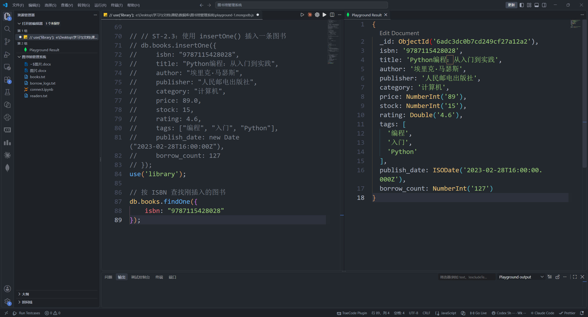
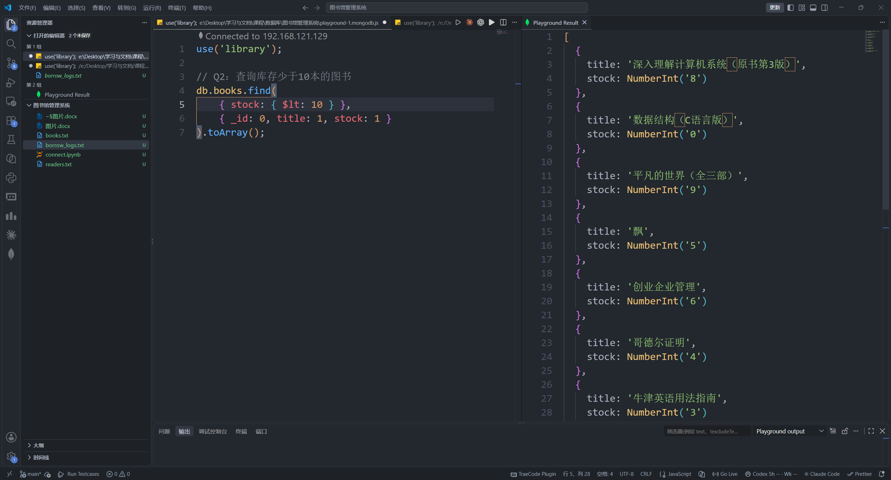
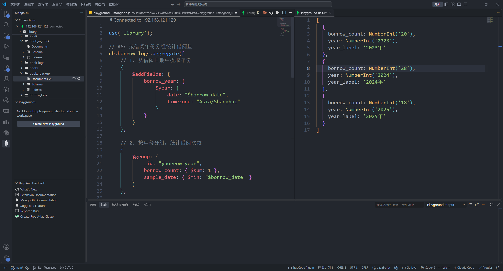
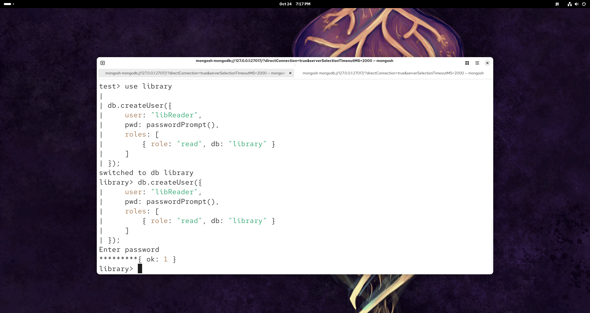
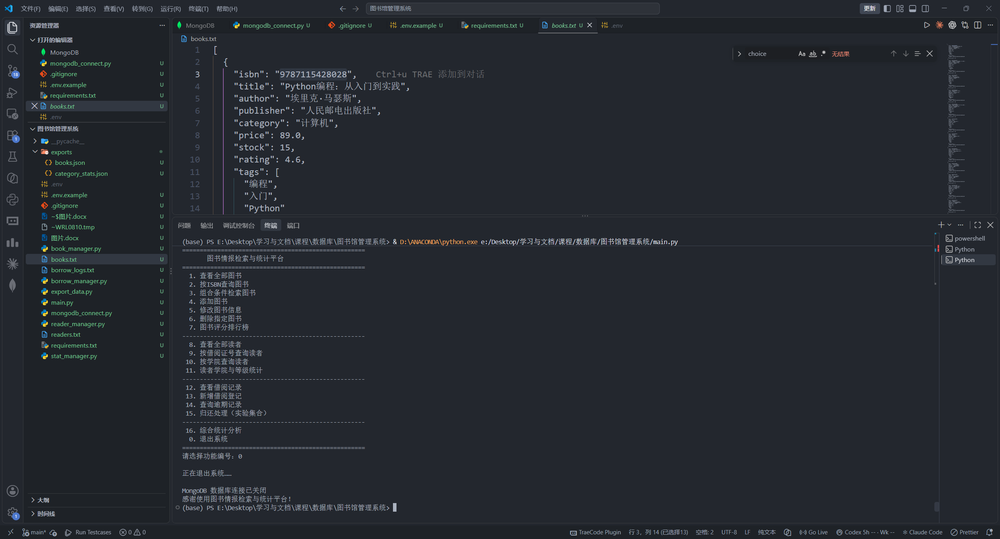
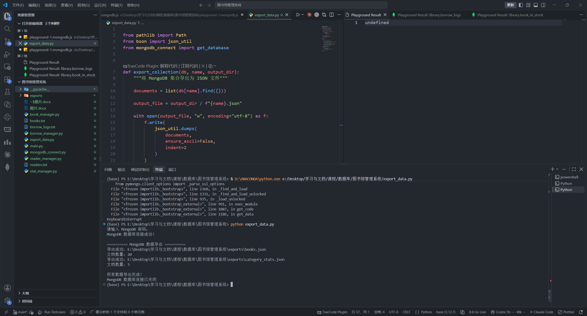

# 图书情报检索与统计平台技术文档

## 一、项目概述

### 1. 项目背景和目标

这个项目是数据库课程的实训项目，目标是做一个可以实际运行的图书情报检索与统计平台。数据库使用 MongoDB，程序使用 Python 和 PyMongo 编写，用户通过命令行菜单完成图书管理、读者查询、借阅登记和统计分析。

系统要解决的主要问题有三个：一是把图书、读者和借阅流水按照不同的数据特点保存；二是用 MongoDB 的条件查询和聚合管道完成检索与统计；三是把数据库操作封装成一个可以反复运行的 Python 程序。

### 2. 业务流程和模块分工

程序从 `main.py` 启动。启动时先读取 `.env`，连接远程 MongoDB，并显示 `books`、`readers`、`borrow_logs` 和 `category_stats` 的数量。用户选择菜单后，主程序负责接收输入、检查参数和二次确认，具体数据库操作交给对应模块。

| 文件 | 主要工作 |
| --- | --- |
| `mongodb_connect.py` | 读取连接配置，创建 `MongoClient`，执行 `ping` 检查 |
| `book_manager.py` | 图书查询、添加、修改、删除和评分排行 |
| `reader_manager.py` | 读者查询、学院统计和等级统计 |
| `borrow_manager.py` | 借阅登记、借阅记录、逾期查询和归还实验 |
| `stat_manager.py` | 分类统计、年度借阅趋势和热门图书排行 |
| `export_data.py` | 将集合导出为 MongoDB Extended JSON |
| `backup_mongodb.py` | 备份集合、索引和视图定义 |

一次操作的流程是：读取参数 → 检查输入 → 生成 MongoDB 查询或更新语句 → 输出匹配数、修改数或删除数 → 返回菜单。程序退出时在 `finally` 中关闭数据库连接。

## 二、环境与数据建模

### 1. 部署环境和关键参数

| 项目 | 配置 |
| --- | --- |
| 本地系统 | Windows 11 |
| 数据库服务器 | CentOS 虚拟机中的 MongoDB 8.0.32 |
| MongoDB 地址 | 实验时使用 `192.168.121.129:27017`，实际地址从 `.env` 读取 |
| 数据库名 | `library` |
| Python | 3.12.7，Anaconda base 环境 |
| Python 驱动 | PyMongo 4.18.2、python-dotenv |
| 开发工具 | Visual Studio Code、MongoDB 扩展 |

安装依赖：

```bash
pip install -r requirements.txt
```

复制配置文件后填写 MongoDB 账号：

```powershell
Copy-Item .env.example .env
```

```dotenv
MONGODB_HOST=192.168.121.129
MONGODB_PORT=27017
MONGODB_DATABASE=library
MONGODB_USERNAME=your_username
MONGODB_PASSWORD=your_password
MONGODB_AUTH_SOURCE=library
```

程序不会把密码写进 Python 文件。`mongodb_connect.py` 创建客户端后先执行 `admin.command("ping")`，数据库服务、虚拟机网络或账号有问题时会在连接阶段报错。

### 2. 四个主要集合

| 集合 | 主要字段 | 设计用途 |
| --- | --- | --- |
| `books` | `isbn`、`title`、`author`、`publisher`、`category`、`price`、`stock`、`rating`、`tags`、`publish_date`、`borrow_count` | 图书基础信息、库存和借阅量 |
| `readers` | `card_no`、`name`、`college`、`level` | 读者基本信息 |
| `borrow_logs` | `reader_card`、`book_isbn`、`borrow_date`、`status`、`return_date` | 借阅流水和状态 |
| `category_stats` | `category`、`book_count`、`total_stock`、`avg_price` | 保存或导出的分类统计结果 |

图书使用 `isbn`，读者使用 `card_no` 作为业务标识。借阅记录通过 `book_isbn` 和 `reader_card` 关联图书与读者，不把所有借阅记录嵌入图书文档，便于按时间查询流水。

### 3. 特殊集合和视图

实训中还验证了三种特殊对象。

1. `book_logs` 是固定集合，容量设置为 1 MB，最多保存 1000 条记录，用来观察固定集合写入后的自动淘汰特点。
2. `borrow_logs` 使用时间序列集合，`borrow_date` 是时间字段，并设置过期时间。时间序列集合在 MongoDB 内部对应 `system.buckets.borrow_logs`，这个桶集合由 MongoDB 自动维护。
3. `book_in_stock` 是基于 `books` 的视图，管道只有一个条件：`stock > 0`。查询视图可以直接得到当前有库存的图书，不需要每次重复写筛选条件。

### 4. 索引设计

项目中经常按 ISBN、分类、评分、读者证号、学院和借阅时间查询，因此设置了唯一索引、普通索引、多键索引和组合索引：

```javascript
db.books.createIndex({isbn: 1}, {unique: true})
db.books.createIndex({title: 1})
db.books.createIndex({category: 1})
db.books.createIndex({tags: 1})
db.books.createIndex({category: 1, price: 1})
db.readers.createIndex({card_no: 1}, {unique: true})
db.readers.createIndex({college: 1})
db.borrow_logs.createIndex({borrow_date: -1})
db.borrow_logs.createIndex({status: 1, borrow_date: -1})
```

通过 `explain("executionStats")` 查看查询计划，重点比较 `COLLSCAN` 和 `IXSCAN`，并检查扫描文档数是否明显减少。

## 三、功能实现、实验步骤和结果

### 1. MongoDB 环境连接和数据准备

先在 CentOS 虚拟机中启动 MongoDB 服务，检查 `mongod.conf` 中的端口和认证配置，再从 Windows 的 VS Code MongoDB 扩展连接 `library` 数据库。连接成功后创建主要集合和特殊对象，导入 `books.txt`、`readers.txt` 和 `borrow_logs.txt` 中的示例数据。

数据导入使用 `insertOne()` 和 `insertMany()`，导入后通过 `countDocuments()` 核对数量。图书数据包含价格、库存、评分、标签和出版日期，借阅流水的 `borrow_date` 使用日期类型，便于后续按年份聚合。



图 1：使用 `insertOne()` 插入图书，并通过 ISBN 查询返回文档。

### 2. 图书和读者检索

图书检索分为三种情况：按 ISBN 精确查询；按书名正则表达式模糊查询；按分类、最低价格、最高价格和库存进行组合查询。查询时使用投影隐藏 `_id`，列表结果按照评分或书名排序。

读者模块按 `card_no` 查询单个读者，按 `college` 查询学院，并使用 `distinct()` 和 `count_documents()` 统计学院、等级分布。输入价格、库存和评分时，主程序会先做数值范围检查，避免无效参数直接进入数据库。



图 2：按库存条件查询图书，结果只返回满足条件的书名和库存字段。

### 3. 图书增删改和借阅登记

新增图书时，程序检查 ISBN、书名、作者、出版社和分类是否为空，并检查价格、库存、评分和出版日期格式。修改图书使用 `$set`，只允许修改业务字段，不允许通过菜单修改 `_id` 和 ISBN。删除前先显示目标文档，用户输入 `YES` 后才执行 `delete_one()` 或批量删除。

借阅登记先检查读者和图书是否存在，再检查库存是否大于 0，最后向 `borrow_logs` 写入：

```python
{
    "reader_card": reader_card,
    "book_isbn": book_isbn,
    "borrow_date": datetime.now(timezone.utc),
    "status": "借出"
}
```

当前实验中的借阅登记只保存流水，不自动扣减 `books.stock`。归还功能先把正式流水复制到 `borrow_return_demo`，再在副本中把状态改成“已归还”，这样便于演示更新过程，也不会直接改动正式时间序列集合。

### 4. 聚合统计和索引验证

`stat_manager.py` 中的分类统计使用 `$group` 计算每类图书数量、库存总量和平均价格，再用 `$project` 和 `$round` 整理输出。借阅趋势使用 `$year` 从 `borrow_date` 提取年份，时区设置为 `Asia/Shanghai`。热门图书按 `borrow_count` 降序排列，再用 `$limit` 取前几名。



图 3：使用聚合管道按年份统计借阅次数，右侧结果显示每年的借阅量。

索引验证通过 `getIndexes()` 和 `explain("executionStats")` 完成。图书 ISBN 的唯一索引用于防止重复图书，`category_price_index` 用于分类和价格组合条件，`tags_multikey` 用于标签数组查询。

### 5. 用户权限和 Compass 核对

在 `library` 数据库中创建只读用户 `libReader` 和读写用户 `libWriter`。只读用户可以执行查询和统计，不能执行插入、修改和删除；读写用户供 Python 程序使用。MongoDB 开启 `authorization: enabled` 后，未认证连接不能直接访问数据库。

在 Compass 中检查数据库连接、集合数量、视图管道、索引名称和用户权限。命令行结果和 Compass 页面互相核对，避免只看程序输出而没有确认数据库中的实际文档。



图 4：使用 mongosh 创建 `libReader` 用户并设置 `read` 权限。

### 6. Python 平台和数据导出

运行 `python main.py` 后，菜单提供 16 项功能，包含图书查询、图书维护、读者查询、借阅记录、逾期查询、归还实验和综合统计。程序通过模块函数调用 PyMongo，主程序只负责菜单和输入。



图 5：Python 主程序启动后显示图书、读者、借阅和统计菜单。

运行 `python export_data.py` 后，在 `exports` 目录生成 `books.json` 和 `category_stats.json`。导出使用 `bson.json_util.dumps()`，可以保留 `ObjectId` 和 `datetime` 的 Extended JSON 表示。运行 `python backup_mongodb.py` 可以保存业务集合、索引信息、视图定义和 `manifest.json`。



图 6：执行 `export_data.py` 后，两个 JSON 文件导出成功并显示文档数量。

## 四、问题与核对

### 1. 调试记录

第一次测试时间序列集合时，历史借阅记录数量比导入数量少，原因是 `expireAfterSeconds` 已经开始生效，早于过期时间的记录被 MongoDB 自动清理。调整测试数据的时间范围和过期时间后，再次导入并查询，结果恢复正常。这个问题说明时间序列集合的 TTL 是按时间字段计算的，不是按导入时间计算的。

配置身份认证时，MongoDB 服务曾经因为 `security.authorization` 的 YAML 缩进位置不正确而启动失败。修正配置层级、重启 `mongod` 并用未认证和已认证连接分别测试后，权限控制恢复正常。

### 2. 命令行和 Compass 结果核对

项目最后使用下面的命令做基本检查：

```bash
python -m py_compile main.py book_manager.py reader_manager.py borrow_manager.py stat_manager.py mongodb_connect.py export_data.py backup_mongodb.py
python main.py
python export_data.py
python backup_mongodb.py
```

检查内容包括：MongoDB 是否能 `ping`；`books`、`readers`、`borrow_logs` 是否能正常查询；新增、修改和删除操作返回的数量是否正确；聚合结果是否与 Compass 中的数据一致；`exports` 和 `backups` 目录是否生成预期文件。

当前版本的限制是借阅登记不会自动扣减库存，归还实验只更新 `borrow_return_demo`。如果继续完善，可以把借阅流水写入、库存扣减和归还恢复放在同一个事务中，避免两个集合的数据出现不一致。

